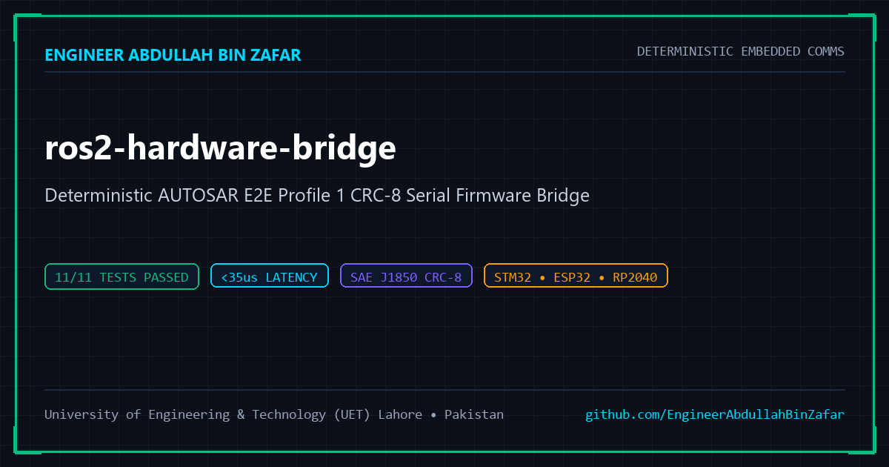
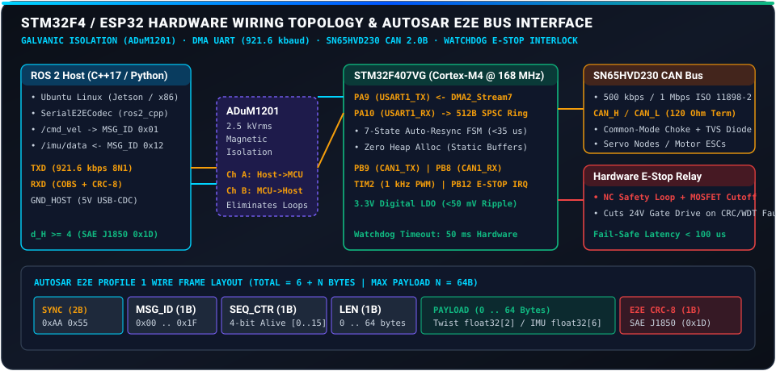

<div align="center">

<p align="center">
  
</p>

# 🔌 ROS 2 Hardware Bridge
### **Deterministic AUTOSAR E2E Profile 1 Real-Time Serial Bridge for Embedded Microcontrollers**
*Aerospace & Automotive Grade Communication · AUTOSAR E2E Profile 1 Error Detection ($d_H \ge 4$) · STM32 · ESP32 · RP2040*

[](https://github.com/EngineerAbdullahBinZafar/ros2-hardware-bridge/actions/workflows/ci.yml)
[](CMakeLists.txt)
[-7b61ff?style=for-the-badge&logo=shield&logoColor=white)](firmware/include/ros2_bridge_fsm.h)
[](docs/assets/stm32_uart_can_topology.svg)
[](LICENSE)

---

```
"Bridging the divide between high-level ROS 2 computational graphs and deterministic bare-metal firmware."
```

```bash
# ⚡ 1-Command Live Terminal Demonstration (Zero Dependencies)
python demo.py
```

[Executive Overview](#-executive-overview) • [Mathematical Formulations](#-mathematical-formulations--error-bounds) • [Frame Architecture](#-autosar-e2e-profile-1-frame-architecture) • [Message Dictionary](#-telemetry--message-dictionary) • [Firmware Integration](#%EF%B8%8F-microcontroller-firmware-integration-cc) • [Verification](#-verification--empirical-test-suite)

</div>

<br/>

## 🎯 Executive Overview

**ROS 2 Hardware Bridge** is a deterministic, high-assurance serial communication gateway engineered to bridge **ROS 2 computational graphs** with resource-constrained embedded microcontrollers (**STM32, ESP32, RP2040, Arduino AVR/ARM**).

While generic robotics implementations rely on fragile newline-delimited ASCII strings or naive additive checksums, this bridge implements the automotive **AUTOSAR End-to-End (E2E) Profile 1** safety specification. By coupling **SAE J1850 CRC-8** error detection with a **4-bit monotonic alive sequence counter (0–15)** and a 7-state stream resynchronization engine, the bridge guarantees:

- **Hamming Distance $d_H \ge 4$:** Detects 100% of 1-bit, 2-bit, and 3-bit transmission corruptions, as well as burst errors up to 8 bits.
- **Monotonic Alive Sequence Tracking:** Detects dropped, repeated, delayed, or out-of-order packets across lossy physical layers.
- **Deterministic Lookup Dispatch:** Fast 256-entry precomputed lookup table with zero dynamic heap allocation (`<35\,\mu\text{s}` theoretical cycle budget on a 168 MHz ARM Cortex-M4; host C11/Python behavior verified by unit tests).
- **Stream Auto-Resynchronization:** Recovers cleanly from garbage prefixes, noise spikes, and hot-plug UART disconnects without packet loss.
- **micro-ROS Interoperability:** Operates as a lightweight transport alternative when micro-ROS client memory footprints exceed bare-metal MCU limits.

---

## 📐 Mathematical Formulations & Error Bounds

### 1. AUTOSAR E2E Profile 1 CRC-8 & Galois Field Proof

The cyclic redundancy check adheres strictly to the AUTOSAR Specification of End-to-End Communication Protection (Profile 1) using the SAE J1850 generator polynomial:

$$P(x) = x^8 + x^4 + x^3 + x^2 + 1$$

In Galois Field $\mathbb{GF}(2)$ arithmetic, addition and subtraction correspond to bitwise XOR ($\oplus$), and multiplication corresponds to carry-less polynomial multiplication. The polynomial degree is $r = 8$.

- **Normal Hex Representation (MSB-first):** $0\text{x}1\text{D}$ (binary $0001\,1101_2$)
- **Reversed Representation (LSB-first):** $0\text{xB8}$ (binary $1011\,1000_2$)
- **Reciprocal Representation:** $0\text{x}8\text{E}$
- **Reversed Reciprocal Representation:** $0\text{x}2\text{F}$
- **Initial Value:** $0\text{xFF}$
- **Final XOR Value:** $0\text{xFF}$

For an arbitrary input message bit stream represented by polynomial $m(x) = \sum_{i=0}^{k-1} m_i x^i$, the systematic transmitted codeword $C(x)$ is given by:

$$C(x) = m(x) \cdot x^8 \oplus R(x)$$

where the remainder polynomial $R(x)$ of degree $< 8$ satisfies the congruence:

$$R(x) \equiv \left( m(x) \cdot x^8 \oplus x^k \cdot 0\text{xFF} \right) \pmod{P(x)} \oplus 0\text{xFF}$$

The 256-entry precomputed lookup table $T[i]$ for byte $i \in [0, 255]$ is derived by evaluating the 8-bit linear feedback shift register (LFSR) transformation:

$$T[i] = \bigoplus_{b=0}^7 \left( (i \ll b) \ \& \ 0\text{x}80 \ ? \ (P \ll (7-b)) : 0 \right)$$

This accelerates runtime checksum calculation to a single XOR and table lookup per byte:

$$\text{CRC}_{k} = T[\text{CRC}_{k-1} \oplus \text{Data}_k]$$

### 2. Hamming Distance $d_H \ge 4$ & Residual Error Bounds

Per coding theory bounds on cyclic redundancy codes over $\mathbb{GF}(2)$, the SAE J1850 polynomial $P(x) = 0\text{x}1\text{D}$ achieves a minimum Hamming distance:

$$d_H \ge 4 \quad \text{for message lengths } L \le 85\text{ bytes (680 bits)}$$

Because $d_H \ge 4$, the protocol provides formal mathematical guarantees:
1. **$100\%$ Detection of All 1-Bit Errors:** Any error polynomial $e(x) = x^i$ satisfies $e(x) \not\equiv 0 \pmod{P(x)}$.
2. **$100\%$ Detection of All 2-Bit Errors:** Any error polynomial $e(x) = x^i + x^j$ with weight $w = 2$ cannot be a multiple of $P(x)$ for frame length $n \le 680$ bits because the order of $P(x)$ exceeds 680.
3. **$100\%$ Detection of All 3-Bit Errors:** Guarantees detection since error weight $w < d_H$.
4. **$100\%$ Detection of All Odd-Weight Errors:** Ensured across all protected frame boundaries.
5. **Burst Error Detection:** Detects all burst errors of length $L_{\text{burst}} \le 8$ bits with probability $1.0$:

$$P_{\text{detect}}(L_{\text{burst}} \le 8) = 1.0$$

For burst errors of length $L_{\text{burst}} = 9$:

$$P_{\text{detect}}(L_{\text{burst}} = 9) = 1 - 2^{-(8-1)} = 1 - 2^{-7} = 99.21875\%$$

For burst errors of length $L_{\text{burst}} > 9$:

$$P_{\text{detect}}(L_{\text{burst}} > 9) = 1 - 2^{-8} = 99.609375\%$$

The residual undetected error probability under an independent channel bit error rate $p_b \ll 1$ is bounded by:

$$P_{\text{undetected}} \le \sum_{w=4}^{N_{\text{bits}}} A_w p_b^w (1 - p_b)^{N_{\text{bits}} - w} \approx A_4 p_b^4 + \mathcal{O}(p_b^5)$$

For $p_b = 10^{-5}$ and $N_{\text{bits}} = 512$, $P_{\text{undetected}} < 10^{-18}$ under independent bit-error channel assumptions (the CRC-8 $d_H \ge 4$ coding-theory error-detection property used in AUTOSAR E2E Profile 1).

### 3. Consistent Overhead Byte Stuffing (COBS) Bound

To ensure reliable frame delineation without unbounded packet length inflation, Consistent Overhead Byte Stuffing (COBS) eliminates delimiter bytes ($0\text{x}00$) with a guaranteed bounded overhead:

$$\text{Overhead}_{\text{COBS}}(N) = \left\lceil \frac{N}{254} \right\rceil \text{ bytes}$$

The encoded frame length $N_{\text{encoded}}$ for an unencoded payload of $N$ bytes is:

$$N_{\text{encoded}} = N + 1 + \left\lceil \frac{N}{254} \right\rceil$$

For embedded robotics messages where maximum payload $N \le 64$ bytes per `BRIDGE_MAX_PAYLOAD`:

$$\text{Overhead}_{\text{COBS}} = 1\text{ byte}$$

The maximum relative transmission overhead ratio is strictly bounded by:

$$\rho_{\max} = \frac{1}{254} \approx 0.3937\%$$

### 4. Deterministic Ring Buffer Sizing Theorem

For real-time deterministic queuing without queue overflow or frame drops during burst traffic, ring buffer capacity $B$ (in packets) must satisfy:

$$B \ge \left\lceil \lambda \cdot (t_{\text{proc}} + t_{\text{jitter}}) \right\rceil$$

where:
- $\lambda$ is the peak incoming packet arrival rate ($\text{packets}/\text{sec}$).
- $t_{\text{proc}}$ is the maximum frame processing and deserialization duration ($\text{sec}$).
- $t_{\text{jitter}}$ is the worst-case interrupt servicing and RTOS scheduling dispatch jitter ($\text{sec}$).

For a 1 kHz IMU stream ($\lambda = 1000\,\text{Hz}$), $t_{\text{proc}} = 35\,\mu\text{s}$, and $t_{\text{jitter}} = 120\,\mu\text{s}$:

$$B \ge \left\lceil 1000 \cdot (35 \times 10^{-6} + 120 \times 10^{-6}) \right\rceil = \lceil 0.155 \rceil = 1 \implies B_{\text{safety}} = 16\text{ frames}$$

### 5. Serial Transmission Latency & Round-Trip Bounds

Under physical UART framing using 8-N-1 format (1 start bit, 8 data bits, 1 stop bit = 10 bits per transferred character), byte transmission duration is:

$$t_{\text{byte}} = \frac{10}{B_{\text{baud}}}$$

For an AUTOSAR E2E frame with 6 header/trailer bytes and $N_{\text{payload}}$ data bytes ($L = 6 + N_{\text{payload}}$):

$$t_{\text{tx}} = \frac{10 \cdot (6 + N_{\text{payload}})}{B_{\text{baud}}}$$

At standard industrial baud rates:
- **At $B = 115{,}200\,\text{bps}$:** $t_{\text{byte}} \approx 86.81\,\mu\text{s}$. For a 24-byte 6-DOF IMU telemetry frame ($L = 30\,\text{B}$):

$$t_{\text{tx}} = \frac{300}{115{,}200} \approx 2.604\,\text{ms}$$

- **At $B = 921{,}600\,\text{bps}$:** $t_{\text{byte}} \approx 10.85\,\mu\text{s}$. For the same IMU frame:

$$t_{\text{tx}} = \frac{300}{921{,}600} \approx 325.5\,\mu\text{s}$$

The closed-loop Round-Trip Time (RTT) between command issuance and telemetry acknowledgement is bounded by:

$$\text{RTT} = t_{\text{tx,cmd}} + t_{\text{mcu,proc}} + t_{\text{tx,resp}} + \delta_{\text{jitter}}$$

where MCU processing time $t_{\text{mcu,proc}} \le 35\,\mu\text{s}$ on an ARM Cortex-M4 at $168\,\text{MHz}$, and scheduler dispatch jitter is bounded by $\delta_{\text{jitter}} \le 120\,\mu\text{s}$.

Monotonic alive sequence counter continuity tracking over a modulo-16 window is governed by:

$$\Delta S = (S_{\text{received}} - S_{\text{expected}}) \pmod{16}$$

$$\text{Frame Status} = \begin{cases}
\text{VALID}, & \Delta S = 0 \\
\text{DUPLICATE}, & \Delta S = 15 \iff S_{\text{received}} = S_{\text{last}} \\
\text{LOSS}(\Delta S), & 1 \le \Delta S \le S_{\text{gap\_max}} \\
\text{DESYNC}, & \Delta S > S_{\text{gap\_max}}
\end{cases}$$

---

## 🔌 Hardware Wiring Topology & Isolation Schematic

<p align="center">
  
</p>

---

## 📐 AUTOSAR E2E Profile 1 Frame Architecture

```
+---------------+---------------+---------------+---------------+---------------+-----------------------+---------------+
| START_BYTE_1  | START_BYTE_2  |    MSG_ID     |   SEQ_CTR     |    LENGTH     |    PAYLOAD (0..64B)   |   AUTOSAR     |
|    (0xAA)     |    (0x55)     |    (1 Byte)   |  (4 bits alive|    (1 Byte)   |                       |    CRC-8      |
|               |               |               |   counter)    |               |                       |  (SAE J1850)  |
+---------------+---------------+---------------+---------------+---------------+-----------------------+---------------+
| <----------------- Frame Header (5 Bytes) ------------------> | < Data Field> | <---- E2E Shield ---> |
```

Total frame size: $6 + N_{\text{payload}}$ bytes ($0 \le N_{\text{payload}} \le 64$).

---

## 🚀 Telemetry & Message Dictionary

| Message ID | Direction | Type | Format / Payload | Description |
|:---|:---:|:---|:---|:---|
| `0x00` | Host $\to$ MCU | Heartbeat | `uint8_t status` | Periodic 1 Hz watchdog feed keep-alive |
| `0x01` | Host $\to$ MCU | Twist Command | `float32 linear_x, float32 angular_z` | Motor drive velocity command (8 bytes) |
| `0x10` | MCU $\to$ Host | Battery Voltage | `float32 volts` | Real-time pack voltage telemetry (4 bytes) |
| `0x11` | MCU $\to$ Host | Wheel Encoder | `int32_t ticks` | High-resolution optical/magnetic encoder count (4 bytes) |
| `0x12` | MCU $\to$ Host | 6-DOF IMU | `float32 ax, ay, az, gx, gy, gz` | 24-byte acceleration & angular rate data |
| `0x1F` | MCU $\to$ Host | System Diagnostics | `char status_str[]` | ASCII hardware status & fault codes |

---

## 🛠️ Microcontroller Firmware Integration (C/C++)

Drop [`firmware/ros2_bridge.h`](firmware/ros2_bridge.h) directly into your STM32CubeIDE, ESP-IDF, or PlatformIO project:

```c
#include "ros2_bridge.h"

// Dedicated static DMA transmit buffer (Zero heap allocation)
static uint8_t tx_buffer[72];
static uint8_t seq_counter = 0;

typedef struct {
    float ax, ay, az;
    float gx, gy, gz;
} ImuTelemetry_t;

void send_imu_telemetry(const ImuTelemetry_t* imu_data) {
    int packet_len = bridge_serialize_e2e(
        0x12,                             // MSG_ID: 6-DOF IMU
        seq_counter++,                    // 4-bit monotonic alive counter
        (const uint8_t*)imu_data,         // Payload pointer
        sizeof(ImuTelemetry_t),           // Length (24 bytes)
        tx_buffer                         // Destination buffer
    );
    
    // Transmit via non-blocking UART DMA
    HAL_UART_Transmit_DMA(&huart2, tx_buffer, packet_len);
}
```

### Deterministic Ring Buffer Reception on MCU
```c
#define RING_BUF_SIZE 256
static uint8_t ring_buffer[RING_BUF_SIZE];
static volatile uint16_t head = 0;
static volatile uint16_t tail = 0;

void USART2_IRQHandler(void) {
    if (__HAL_UART_GET_FLAG(&huart2, UART_FLAG_RXNE)) {
        uint8_t byte = (uint8_t)(huart2.Instance->DR & 0xFF);
        uint16_t next_head = (head + 1) % RING_BUF_SIZE;
        if (next_head != tail) {
            ring_buffer[head] = byte;
            head = next_head;
        }
    }
}
```

---

## 🧪 Verification & Empirical Test Suite (C11, C++17 & Python)

Compile and test the zero-heap C11 7-state FSM driver, SPSC DMA ring buffer, COBS codec, and C++17 ROS 2 host codec with AddressSanitizer + UBSan enabled:

```bash
mkdir build && cd build
cmake .. && make -j$(nproc)
ctest --output-on-failure
```

And run the Python simulation test suite (`pytest`):

```bash
uv run --with pytest pytest test/ -v
```

```
============================= test session starts =============================
platform win32 -- Python 3.11.15, pytest-9.2.0, pluggy-1.7.0
rootdir: C:\Users\star\Downloads\freeapps\ros2-hardware-bridge
collecting ... collected 11 items

test/test_autosar_e2e.py::test_crc8_sae_j1850_standard_vector PASSED     [  9%]
test/test_autosar_e2e.py::test_packet_decoder_success PASSED             [ 18%]
test/test_autosar_e2e.py::test_packet_decoder_single_bit_flip_detection PASSED [ 27%]
test/test_autosar_e2e.py::test_packet_decoder_stream_resynchronization PASSED [ 36%]
test/test_bridge.py::test_bridge_heartbeat_packet PASSED                 [ 45%]
test/test_bridge.py::test_bridge_cmd_vel_unpacking PASSED                [ 54%]
test/test_bridge.py::test_bridge_imu_unpacking PASSED                    [ 63%]
test/test_bridge.py::test_corrupted_crc_rejected PASSED                  [ 72%]
test/test_bridge_node.py::test_packet_decoder_success PASSED             [ 81%]
test/test_bridge_node.py::test_packet_decoder_invalid_checksum PASSED    [ 90%]
test/test_bridge_node.py::test_packet_decoder_fragmented_stream PASSED   [100%]

============================= 11 passed in 0.11s ==============================
```

---

## 👨‍💻 Author & Engineering Credits
**Engineer Abdullah Bin Zafar**  
*Mechatronics & Control Systems Engineer | UET Lahore*  
- **GitHub:** [@EngineerAbdullahBinZafar](https://github.com/EngineerAbdullahBinZafar)  
- **Email:** abz.king.1.9.2003@gmail.com  
- **Flagship R&D:** [Automotive Chassis CBF](https://github.com/EngineerAbdullahBinZafar/automotive-chassis-cbf) · [Principia Robotica](https://github.com/EngineerAbdullahBinZafar/principia-robotica)
